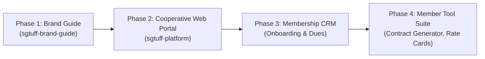

# SGTUFF Co-operative Ltd: Brand & Strategic Objectives

**Entity:** SGTUFF Co-operative Ltd  
**Project:** `sgtuff-brand-guide`  
**Classification:** P1 Core Entity Initiative  
**Last Updated:** 21 October 2026  

---

## 1. Executive Purpose & Strategic Mission
SGTUFF Co-operative Ltd is established to serve as the unified cooperative backbone for Singapore's independent workforce, creative technologists, freelancers, and agile enterprises.

### Core Strategic Mandates:
1. **Economic Solidarity & Collective Bargaining:** Pool resources to secure corporate-grade healthcare, insurance, dispute mediation, and statutory protections for independent professionals.
2. **Professional Elevation & Standards:** Foster accredited competency frameworks, peer-reviewed standard contracts, and transparent fair-tenancy/fair-work practices.
3. **Cooperative Ownership & Dividend Distribution:** Ensure surplus returns and platform governance flow directly back to registered cooperative members.

---

## 2. Target Member Profiles & Personas
* **Persona A: Creative Technologists & Developers:** Freelancers and digital agency consultants requiring robust contracts, cross-border invoicing standards, and collective benefits.
* **Persona B: Gig & Independent Media Specialists:** Photographers, videographers, copywriters, and production crew needing industry rate benchmarks and payment protection.
* **Persona C: Boutique Founders & Small Enterprises:** Micro-agencies seeking trusted peer subcontractors and cooperative bulk discounts on software and workspace facilities.

---

## 3. Brand Identity Pillars & Tone of Voice
* **Pillar 1: Institutional Trust (Solidarity & Governance):** Grounded in Singapore cooperative statutory compliance. We are steady, legitimate, and accountable.
* **Pillar 2: Modern Tech Competence (Forward-Looking):** We speak the language of modern digital creators and developers, avoiding outdated bureaucratic jargon.
* **Pillar 3: Uncompromising Advocacy (In the Member's Corner):** Fierce champions of fair compensation, swift invoice settlement, and intellectual property respect.

### Tone of Voice Matrix:
| Dimension | What SGTUFF Is | What SGTUFF Is Not |
| :--- | :--- | :--- |
| **Authority** | Credible, backed by law and collective strength | Stuffy, bureaucratic, or academic |
| **Warmth** | Welcoming, collegial, community-driven | Casual to the point of unprofessional |
| **Urgency** | Action-oriented, practical, delivering tools | Vague philosophical manifesto |

---

## 4. Multi-Phase Roadmap for SGTUFF

1. **Phase 1: Brand Guide (`sgtuff-brand-guide`) [CURRENT]**:
   - Establish official color tokens, typography scales, SVG brand assets, and tone guide.
   - Produce living interactive brand book and exportable Tailwind theme preset.
2. **Phase 2: Web Platform (`sgtuff-platform`)**:
   - Public-facing showcase, mission landing page, co-op leadership registry, and initial membership application funnel.
3. **Phase 3: Membership CRM & Portal**:
   - Secure member login, cooperative share capital tracking, automated annual dues, and verified credentials.
4. **Phase 4: Member Utility Suite**:
   - Fair contract builder, Singapore rate-card screener, prompt-payment escalation tools, and cooperative perks directory.
